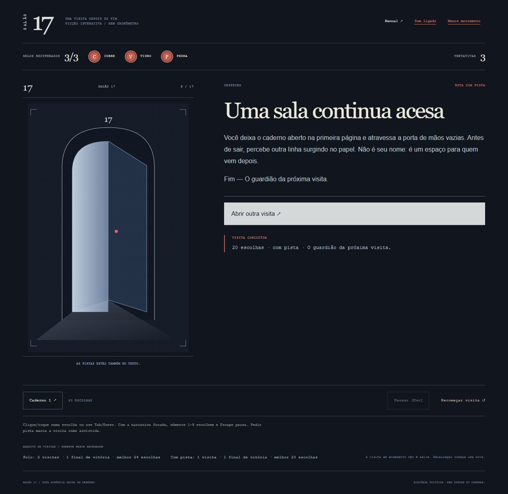

# Salão 17

**O museu guarda a última palavra.** Um escape narrativo original: explore três salas, interprete pistas, recupere os selos e decida o destino de um caderno.

[Jogar gratuitamente](https://gustapaz.github.io/salao-17/)

## A visita

- Arquivo: descubra a ordem dos símbolos.
- Galeria: oriente três obras em quatro direções.
- Oficina: equilibre pesos segundo uma rosácea.
- Três erros de validação encerram a visita inteira. Observar e manipular não consome tentativas.
- Dois finais de vitória, um de derrota; pistas opcionais e caderno de anotações.
- Recordes locais separados entre solo e com ajuda. Reinício completo a qualquer momento.

## Controles

Clique ou toque nas escolhas; Tab/Enter para navegar. Com a narrativa focada, 1–9 selecionam escolhas e Escape pausa. O jogo também pausa ao perder foco. Som opcional e movimento reduzido. Não há cronômetro, arraste ou gamepad.

## Stack e execução

Ink é a fonte da narrativa, regras e inventário. inkjs executa a história compilada; TypeScript conecta o estado ao DOM e aos cenários SVG. Vite gera um site estático.

Requer Node.js 24 e npm.

```sh
npm ci
npm run dev
npm test
npm run build
npm run preview
```

O JSON de Ink é gerado automaticamente antes de testar, desenvolver e construir. `story/museum.ink` é a fonte editável. CI testa, audita dependências e publica somente `dist` no GitHub Pages.

## Privacidade e limites

Sem conta, backend, serviços pagos, chaves, publicidade ou compras. Preferências e resultados ficam no localStorage deste navegador; a visita em andamento não é salva. Não existe ranking online, sincronização entre dispositivos ou garantia de funcionamento offline. Dados locais podem ser apagados pelas configurações do navegador. Resultados locais não são protegidos contra alteração pelo próprio jogador.

História fictícia, arte e áudio procedural próprios. [Assets e licenças](docs/assets.md), [design](docs/game-design.md) e [validação](docs/validation.md).

Código MIT. A licença de inkjs acompanha o export em `third-party.txt`.


